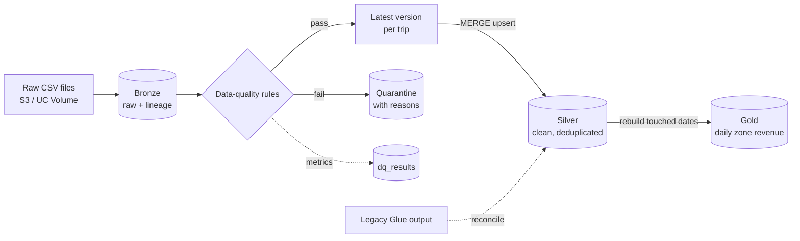

# AWS Glue → Databricks Lakehouse Migration

[](../../actions/workflows/ci.yml)


A worked example of migrating a typical **AWS Glue PySpark job** to a **Databricks + Delta Lake medallion pipeline**, with idempotent upserts, data-quality quarantine, reconciliation against the legacy output, unit/end-to-end tests, CI, and one-command deployment via Databricks Asset Bundles.

All data is **synthetic** (generated by `data/generate_sample_data.py`), so the whole project runs anywhere with no cloud account and no downloads.

---

## The problem

The legacy job ([`legacy/glue_job_trips.py`](legacy/glue_job_trips.py)) is a pattern found in many AWS data lakes: read CSV with job bookmarks, `ApplyMapping`, `Filter`, append Parquet to S3. It works until it doesn't:

| Symptom in production | Root cause in the Glue job |
| --- | --- |
| Duplicate trips after a re-run or a resent file | Append-only Parquet writes |
| Corrected trips from the source never show up | No upsert; a correction is just another appended row |
| Revenue totals drift and nobody can say why | Bad rows silently dropped by `Filter`, no metrics |
| Reprocessing one day is risky and manual | State hidden in Glue job bookmarks |
| "Is the data right?" has no answer | No reconciliation, no tests |

## The solution



| Layer | Table | What it guarantees |
| --- | --- | --- |
| Bronze | `bronze_trips` | Every raw row kept as strings, with source file, ingest time and batch ID |
| Silver | `silver_trips` | Typed, validated, one row per `trip_id`; newer corrections win, stale ones are ignored |
| Quarantine | `quarantine_trips` | Rejected rows plus the list of rules each one failed |
| DQ metrics | `dq_results` | Failures per rule per batch, so data loss is visible over time |
| Gold | `gold_daily_zone_revenue` | Trips, revenue, average distance/duration and tip rate per day and zone |

### Design decisions

- **Idempotent by construction.** Silver is written with Delta `MERGE` keyed on `trip_id`, and an update applies only when `source.updated_at > target.updated_at`. Re-running a batch changes nothing, and a late, stale resend can't overwrite newer data. Both behaviours are covered by tests.
- **Deduplicate before merging.** If a batch contains several versions of one trip, `latest_per_key` keeps the newest, so `MERGE` never sees ambiguous matches.
- **Quarantine, don't drop.** Rules are declared in one list (`quality.RULES`) with `error` / `warn` severity. Errors are quarantined with reasons; warnings are kept and counted.
- **ANSI-safe parsing.** `try_cast` / `try_to_timestamp` turn malformed values into NULLs that the rules catch, instead of crashing the job (Databricks enables ANSI SQL mode).
- **Incremental gold.** Only the dates touched by a batch are recomputed, using Delta `replaceWhere`.
- **One codebase, two environments.** `config.py` maps table names to local Delta folders or to Unity Catalog `catalog.schema.table`; nothing else changes.
- **Serverless-friendly.** No `.cache()` and no cluster-specific config, so the job runs on Databricks serverless compute, including Free Edition.

---

## Repository layout

```
├── legacy/glue_job_trips.py        # the "before": representative AWS Glue job (reference only)
├── src/trip_pipeline/
│   ├── config.py                   # local vs Databricks table naming
│   ├── schemas.py                  # explicit raw + silver schemas
│   ├── transforms.py               # pure functions: standardize, dedupe, aggregate
│   ├── quality.py                  # declarative DQ rules, quarantine, metrics
│   ├── pipeline.py                 # bronze -> silver (MERGE) -> gold (replaceWhere)
│   ├── reconcile.py                # legacy vs new comparison report
│   ├── io.py / spark.py            # Delta read/write helpers, SparkSession factory
├── jobs/run_pipeline.py            # CLI entry point (local + Databricks job)
├── data/generate_sample_data.py    # synthetic batches incl. bad rows, corrections, duplicates
├── tests/                          # unit + end-to-end tests on local Spark/Delta
├── databricks.yml                  # Asset Bundle: serverless job definition
├── docs/migration_mapping.md       # Glue concept -> Databricks equivalent, migration checklist
└── .github/workflows/ci.yml        # lint + tests + full pipeline run on every push
```

## Run it locally

Requires Python 3.10+ and Java 17.

```bash
pip install -r requirements.txt
make data     # writes data/raw/batch_1 and data/raw/batch_2
make run      # runs both batches through bronze -> silver -> gold
make test     # unit + end-to-end tests
```

Delta tables are written under `_lakehouse/`. Batch 2 deliberately contains corrections to batch-1 trips, an exact resend, a stale correction and an in-batch duplicate, so you can check that silver ends up correct.

## Run it on Databricks (Free Edition works)

1. In a SQL editor or notebook:
   ```sql
   CREATE SCHEMA IF NOT EXISTS workspace.trips_demo;
   CREATE VOLUME IF NOT EXISTS workspace.trips_demo.raw;
   ```
2. Upload `data/raw/batch_1/trips.csv` and `data/raw/batch_2/trips.csv` into the volume as folders `batch_1/` and `batch_2/`.
3. Deploy and run with the [Databricks CLI](https://docs.databricks.com/dev-tools/cli/index.html):
   ```bash
   databricks bundle deploy
   databricks bundle run trips_pipeline                       # batch_1
   databricks bundle run trips_pipeline --params batch=batch_2
   ```
4. Explore:
   ```sql
   SELECT * FROM workspace.trips_demo.gold_daily_zone_revenue ORDER BY pickup_date, revenue DESC;
   SELECT rule, SUM(failed_rows) FROM workspace.trips_demo.dq_results GROUP BY rule;
   DESCRIBE HISTORY workspace.trips_demo.silver_trips;
   ```

## Reconciling against the legacy output

During a real migration both pipelines run in parallel, and every difference has to be explained before cut-over:

```python
from trip_pipeline.reconcile import reconcile

legacy = spark.read.parquet("s3://legacy-bucket/trips/")   # Glue output
new = spark.read.table("workspace.trips_demo.silver_trips")
report = reconcile(legacy, new)
print(report.as_dict())
# keys only in legacy / only in new, row-hash mismatches, column totals, passed: True/False
```

Expected, explainable differences in this scenario: legacy duplicates from append-only writes (removed in silver), and corrected trips that legacy never updated.

## Tests

| Test file | What it proves |
| --- | --- |
| `test_transforms.py` | Casting, trimming, payment-code mapping, bad timestamps become NULL, latest-version dedupe, gold aggregates |
| `test_quality.py` | Each rule catches its defect, warnings don't quarantine, per-rule metrics are correct |
| `test_pipeline_end_to_end.py` | Two batches through all layers: newer correction wins, stale correction ignored, re-run is idempotent |
| `test_reconcile.py` | Detects missing, extra and changed rows; handles legacy duplicates |

CI runs lint, all tests and the full pipeline on every push.

## What I'd add for production

- Auto Loader (`cloudFiles`) for incremental file discovery instead of batch folders
- Lakeflow Declarative Pipelines expectations as an alternative to the custom rules engine
- Alerting on `dq_results` thresholds (for example, more than 1% of rows quarantined in a batch)
- Liquid clustering on `silver_trips` instead of date partitioning at larger scale

---

**Author:** Nimisha Reddy, Senior Data Engineer (Azure & AWS · Databricks · PySpark) · [LinkedIn](https://www.linkedin.com/in/nimisha-reddy-6a639331b)
